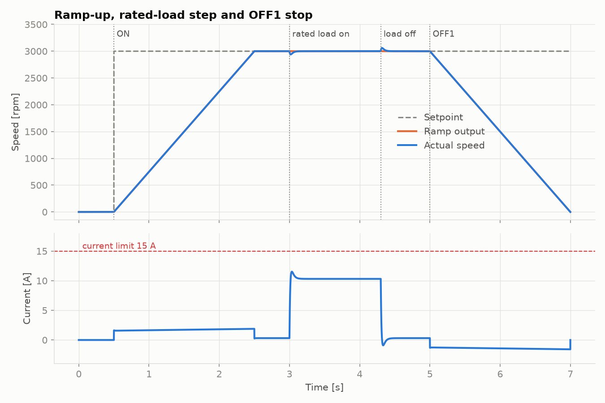
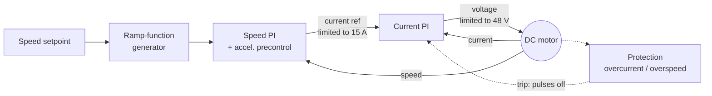
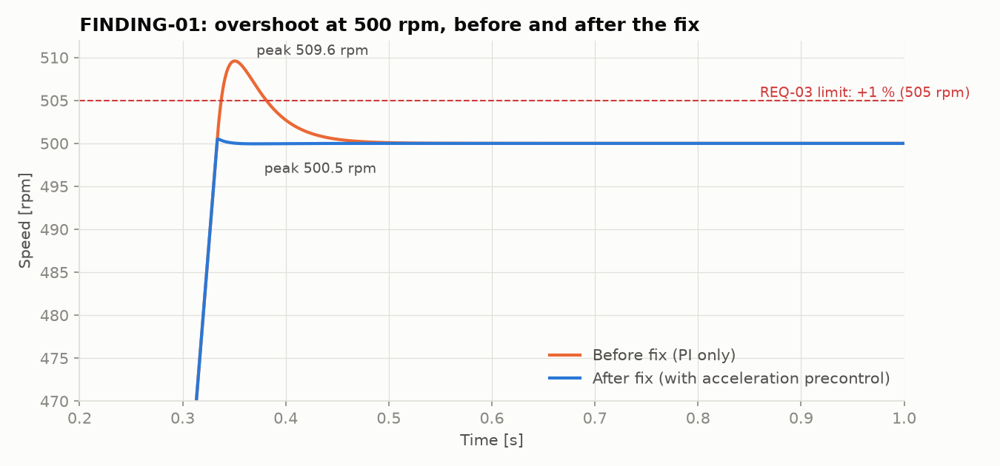
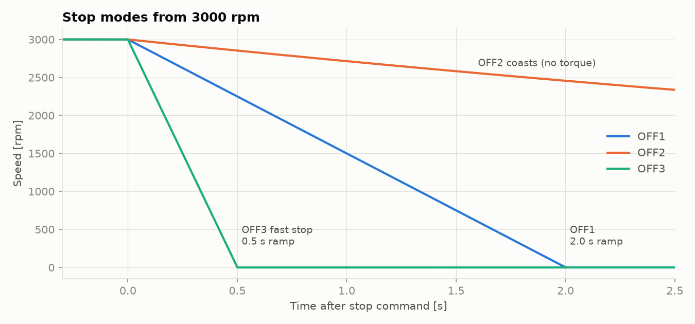
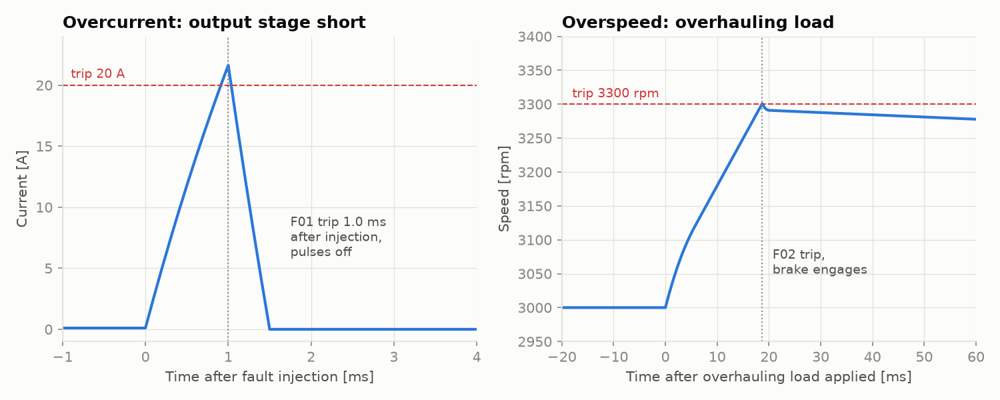

# drive-sim: Requirements-based testing of a simulated motor drive


A simulated variable-speed DC motor drive with cascaded speed and current control, a ramp-function generator, OFF1/OFF2/OFF3 stop modes and overcurrent/overspeed protection. It is verified against 14 written requirements by an automated pytest suite that generates a requirements traceability matrix on every run.

I built it to learn how drive systems behave and how they are tested: requirements, test levels, fault injection, root-cause analysis and traceability.



## Contents
- [What the drive does](#what-the-drive-does)
- [How it is tested](#how-it-is-tested)
- [Results and findings](#results-and-findings)
- [Run it](#run-it)
- [Project structure](#project-structure)

---

## What the drive does

A motor drive (inverter / converter) sits between the power supply and the motor. It controls the voltage applied to the motor so the motor runs at the commanded speed, whatever the load does, and it protects the motor and the machine.



| Function | What it means | Default |
|---|---|---|
| **Cascaded control** | The outer speed loop decides how much current (torque) is needed. The inner, faster current loop decides the voltage. | ~500 Hz current loop |
| **Ramp-function generator** | Limits how fast the setpoint may change, for smooth mechanics and no current spikes | 2 s for 0 → 3000 rpm |
| **Current limit** | Caps motor current (and so torque) during acceleration or a blocked shaft | 15 A |
| **OFF1** | Normal stop: ramp down, then switch off | 2.0 s ramp |
| **OFF2** | Coast stop: switch off immediately, the motor spins down freely | — |
| **OFF3** | Fast stop: ramp down with a short ramp | 0.5 s ramp |
| **Overcurrent trip F01** | Switches off within one control cycle if the current exceeds the trip level | 20 A |
| **Overspeed trip F02** | Trips if the motor is driven too fast, e.g. by an overhauling load | 3300 rpm |
| **Fault handling** | Faults are latched. Acknowledge only works once the cause is gone, and the drive never restarts by itself | — |

These are the same concepts found on industrial drives. For example, Siemens SINAMICS configures them with parameters such as p1120/p1121 (ramp-up/down time), p1135 (OFF3 ramp-down time), p0640 (current limit) and p1082 (maximum speed).

The motor model is the standard DC-motor equation pair (electrical `L·di/dt = V − R·i − Ke·ω`, mechanical `J·dω/dt = Kt·i − B·ω − T_load`). The model itself is verified against the analytical steady-state speed and the electrical time constant.

---

## How it is tested

### Test levels
| Level | Files | What is verified |
|---|---|---|
| **Component** | `test_motor_model.py`, `test_controller.py`, `test_ramp.py` | Motor physics against textbook formulas, PI anti-windup and limits, ramp rates |
| **System (requirements)** | `test_drive_requirements.py` | The complete drive against [`requirements.toml`](requirements.toml), one or more tests per requirement |

### Requirements and traceability
Requirements live in a single file, [`requirements.toml`](requirements.toml), each with an ID, measurable acceptance criteria and a category:

```toml
[REQ-05]
title = "Load disturbance rejection"
text  = "A rated-load torque step at 1500 rpm shall cause a speed dip of at most 100 rpm,
         and the speed shall be back within +/- 10 rpm within 0.2 s."
```

Tests declare what they verify:

```python
@pytest.mark.req("REQ-05")
def test_rated_load_step_dip_and_recovery(make_drive): ...
```

A small pytest plugin (`tests/conftest.py`) then:
- rejects tests that reference a requirement that doesn't exist;
- after every run, writes `reports/traceability.md`, mapping each requirement to its tests and results and flagging any requirement with **no test**;
- in CI, publishes the matrix to the GitHub Actions job summary.

### Test design techniques
- **Boundary values:** stop times and ramp times are checked against both a lower and an upper limit, current against limit + 2 %, and trip time against 1 ms.
- **Equivalence classes and parametrisation:** small, medium and maximum setpoints, both rotation directions, with and without load.
- **Fault injection:** a short-circuited output stage (overcurrent), a locked rotor (current limit) and an overhauling crane-type load (overspeed).
- **State-transition testing:** ON → OFF1/2/3 → READY, FAULT → acknowledge → READY, and no automatic restart.

---

## Results and findings

**59 tests, 14/14 requirements covered and passing**, on Python 3.11–3.13 in CI.

Running the suite found **one product defect and two test defects**. All three are root-caused in [`docs/FINDINGS.md`](docs/FINDINGS.md).

**FINDING-01:** The speed overshot by a constant 9.6 rpm after every ramp, so REQ-03 failed only at low setpoints (1.9 % at 500 rpm). Root cause: the speed controller's integrator was carrying the acceleration current. The fix was acceleration precontrol (feed-forward), which brought the overshoot down to 0.5 rpm.



<table><tr>
<td></td>
<td></td>
</tr></table>

---

## Run it

```bash
python -m venv .venv
source .venv/bin/activate        # Windows: .venv\Scripts\activate
pip install -e ".[dev]"

pytest                           # all tests + reports/traceability.md
pytest -m req -v                 # system/requirement tests only
pytest -k overcurrent            # one area
python scripts/plot_scenarios.py # regenerate the figures in docs/img
```

Use the drive directly:

```python
from drivesim import Drive, Simulation

drive = Drive()
trace = Simulation(drive).run(4.0, schedule=[
    (0.0, "start", lambda d: (d.set_speed(1500), d.on())),
    (2.5, "stop",  lambda d: d.off1()),
], load=lambda t: 0.5 if t < 2.5 else 0.0)   # load torque in N*m
print(trace.at("speed_rpm", 2.0))            # ~1500
print(drive.state)                           # DriveState.READY
```

## Project structure

```
drivesim/
  motor.py          DC motor model (electrical + mechanical)
  controller.py     PI controller with limits and anti-windup
  ramp.py           Ramp-function generator
  drive.py          Control cascade, stop modes, protection, fault handling
  simulation.py     Scenario runner + recorded Trace with analysis helpers
tests/
  conftest.py       Fixtures + traceability plugin
  test_*.py         Component and requirement tests
requirements.toml   The 14 requirements
docs/
  FINDINGS.md       Defects found, with root cause and fix
  img/              Figures generated by scripts/plot_scenarios.py
```
