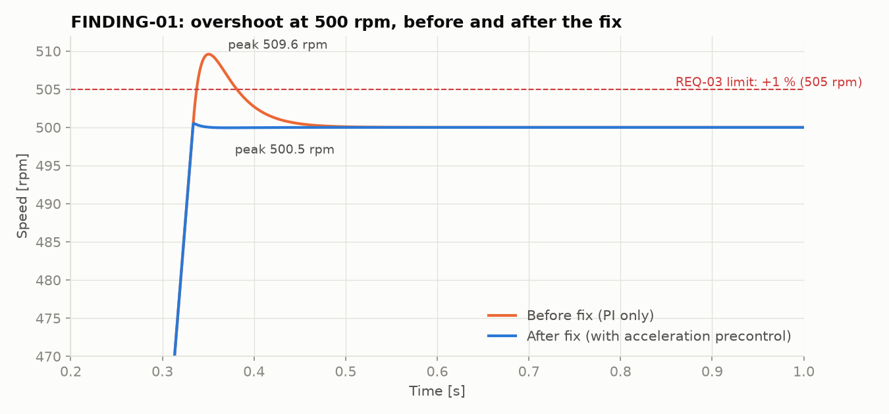

# Findings Log

Issues found while running the requirement tests, with root-cause analysis.
Product defects are listed first. Test defects follow: a failing test is not always a product bug.

## FINDING-01: Speed overshoot exceeds 1 % at low setpoints

| | |
|---|---|
| **Type** | Product defect (control design) |
| **Requirement** | REQ-03 Overshoot ≤ 1 % of setpoint |
| **Severity** | Medium. Process quality, not safety |
| **Found by** | `test_overshoot_is_below_one_percent[500]` |
| **Status** | Fixed and verified |

**Observation**

| Setpoint | Overshoot | % of setpoint | REQ-03 |
|---|---|---|---|
| 500 rpm | 9.6 rpm | 1.92 % | ❌ |
| 1500 rpm | 9.6 rpm | 0.64 % | ✅ |
| 3000 rpm | 9.6 rpm | 0.32 % | ✅ |

The overshoot was a **constant ~9.6 rpm, independent of the setpoint**. That's why only the low-speed test case failed. A test suite that only tested at 1500 and 3000 rpm would have missed it.

**Root cause analysis**
1. The overshoot does not depend on the setpoint, but it does depend on the ramp rate. So it comes from the *acceleration*, not from the target speed.
2. During the ramp, the motor needs a constant extra current to accelerate the inertia (`J · dω/dt / Kt` ≈ 1.6 A). With a plain PI speed controller, the only part that can supply a constant current is the **integrator**, so the integrator "stores" the acceleration current.
3. When the ramp ends, the acceleration is no longer needed, but the integrator still holds that current. It can only unwind by building up a negative speed error, which is the overshoot.

**Fix:** Added **acceleration precontrol**, a common feature in industrial drives. The current needed for the ramp is fed forward directly (`i_ff = J · dω_ref/dt / Kt`), so the speed PI only corrects real errors. It can be switched off with `DriveConfig.accel_precontrol` to reproduce the original behaviour.

**Verification:** The overshoot is now 0.5 rpm at all setpoints (0.10 % at 500 rpm). All REQ-03 test cases pass, and the other 13 requirements were re-run with no regressions.

---

## TEST-01: OFF2 test used a load profile that reversed the motor

| | |
|---|---|
| **Type** | Test defect |
| **Requirement** | REQ-10 OFF2 coast stop |
| **Status** | Test corrected |

**Observation:** `test_off2_...` failed with a speed of −3186 rpm one second after OFF2.

**Analysis:** The test applied a *constant* 0.5 N·m load torque the whole time. After OFF2 the motor has no torque, so a constant load torque doesn't just slow the shaft: it accelerates it **backwards**. Real friction-type loads don't do that. The product behaved correctly; the test stimulus was unrealistic.

**Correction:** The load is now applied only while the drive is running, which still gives current to switch off at the OFF2 instant. An assertion was added to make sure that current really is there, so the test can't pass vacuously.

## TEST-02: Acknowledge test checked the fault cause too late

| | |
|---|---|
| **Type** | Test defect |
| **Requirement** | REQ-13 Fault latching and acknowledge |
| **Status** | Test corrected |

**Observation:** The test expected the speed to still be above the 3300 rpm trip level after the trip, but it measured 3265 rpm.

**Analysis:** The scenario engaged the holding brake at the moment of the trip, so the "fault cause still present" condition the test wanted to exercise never existed. The test was not testing what its name said.

**Correction:** The overhauling load now keeps acting until the test explicitly engages the brake. The test checks that acknowledge is **rejected** while the motor is above the trip speed, then engages the brake and checks that acknowledge is **accepted** once the speed is back in range.
